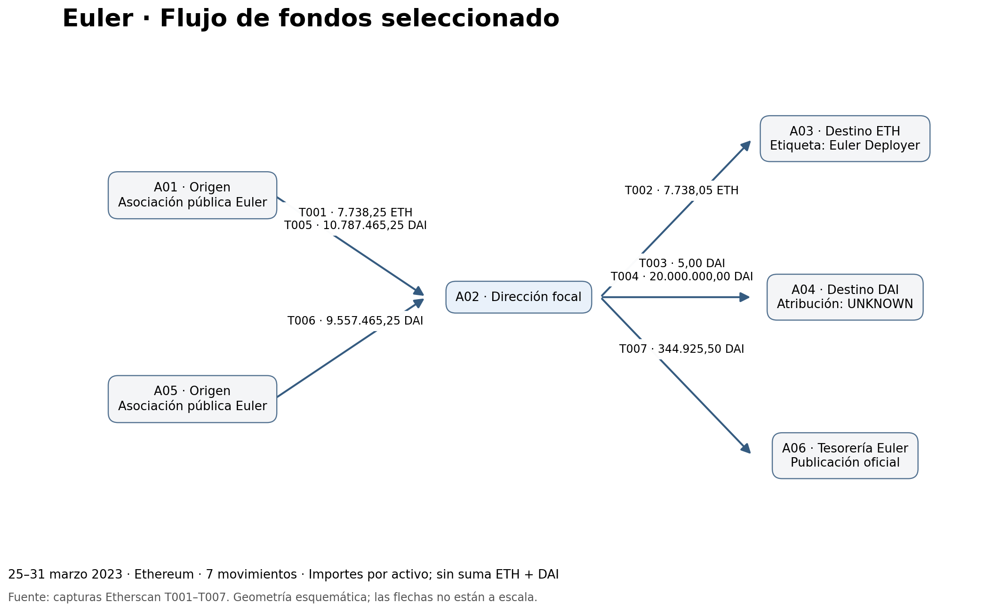

# Euler Finance · Investigación on-chain

**Siete movimientos públicos en Ethereum, documentados desde Etherscan y analizados con Python.**

Portfolio educativo de Maximiliano Sosa: trazabilidad de fondos, revisión de contrapartes y disciplina de evidencia aplicadas a una muestra del período posterior al incidente de Euler. Proyecto realizado con asistencia de IA declarada en la bitácora; no representa trabajo contratado por un exchange.

## Lectura en dos minutos

- **Alcance:** siete transacciones, seis direcciones, ETH y DAI; 25–31 de marzo de 2023.
- **Pregunta:** cómo se conectan las entradas y salidas seleccionadas de la dirección `0xa1b44d4b5b4c361f51e029b81bf2db9cf4d8e676` y qué puede sostenerse sobre sus contrapartes.
- **Resultado:** 20.344.930,50 DAI recibidos y el mismo importe enviado dentro de la muestra. No se afirma un saldo final cero.
- **Patrón:** 5 DAI y luego 20.000.000 DAI hacia el mismo destino, separados por 216 segundos. La posible transferencia de prueba se presenta como hipótesis.
- **Atribución:** una salida de 344.925,50 DAI llega a la dirección publicada por Euler Foundation como tesorería. El receptor de los 20 millones sigue sin atribución validada.
- **Límite:** no se demuestra lavado, identidad personal, recuperación completa ni depósito en un exchange.

**Archivo principal:** [Notebook con informe, código, resultados y evidencia](euler-investigacion/investigacion_euler.ipynb). Para leer sin Python, descargar y abrir [la versión HTML](euler-investigacion/investigacion_euler.html) en un navegador. GitHub puede mostrar el HTML como código; la versión descargada contiene las imágenes.



## Reproducir en Colab

1. Descargar `euler-investigacion/investigacion_euler.ipynb`.
2. Abrir Google Colab y elegir **Archivo → Subir notebook**.
3. Seleccionar **Entorno de ejecución → Ejecutar todo**.
4. Revisar los controles y las figuras. Los archivos derivados aparecen en `salidas_euler/`.

El notebook contiene datos y capturas: funciona sin archivos auxiliares ni claves API. Si faltan dependencias, ejecutar `%pip install pandas networkx matplotlib`. **Reproduce cálculos sobre datos transcritos; no descarga nuevas transacciones.**

En un entorno local con Python 3.12, instalar `requirements.txt` y ejecutar:

```bash
python -m pip install -r requirements.txt
python -m jupyter nbconvert --execute --to notebook --inplace investigacion_euler.ipynb
```

La entrega fue ejecutada celda por celda en orden mediante IPython en proceso, con salidas guardadas. Los sockets del entorno de construcción impidieron iniciar un kernel Jupyter independiente. La ejecución específica en Colab no fue comprobada. Ver [validación](docs/validacion.md).

## Estructura

| Archivo o carpeta | Contenido |
|---|---|
| `investigacion_euler.ipynb` | Entregable autónomo: informe, dataset, código, figuras y capturas |
| `investigacion_euler.html` | Lectura sin ejecución, con imágenes incorporadas |
| `datos/` | CSV de transacciones, atribuciones, métricas y manifiesto; GraphML y versiones |
| `evidencia/` | Siete capturas originales, sin alterar |
| `visualizaciones/` | Flujo de fondos y conciliación DAI |
| `docs/validacion.md` | Controles y límites de la validación |
| `docs/publicacion_y_portfolio.md` | Publicación manual, CV y LinkedIn |
| `requirements.txt` | Versiones usadas para generar esta entrega |

## Fuentes y método

Las transacciones provienen de capturas aportadas durante la revisión manual. Cada registro contiene enlace Etherscan; el manifiesto registra SHA-256. Las atribuciones externas se contrastan con [Coinbase Unit 0x](https://www.coinbase.com/blog/euler-compromise-investigation-part-2-the-redemption) y [Euler Foundation](https://euler.foundation/euler-DAO/treasury). El [relato oficial de Euler](https://www.euler.finance/blog/war-peace-behind-the-scenes-of-eulers-240m-exploit-recovery) aporta contexto.

Una fila representa un movimiento seleccionado. Los destinatarios del token se separan del contrato llamado. Los importes se conservan como decimales; no se mezclan ETH y DAI ni se inventan cotizaciones históricas. Las etiquetas son atribuciones externas, no hechos inscritos como identidad en blockchain.

## Limitaciones

Muestra intencional de siete operaciones; historial no exhaustivo; sin recibos RPC ni índices de logs; precisión limitada a lo mostrado en capturas; comisiones incompletas; sin KYC ni registros internos de servicios. Dos destinatarios completos se copiaron manualmente, mientras las capturas los muestran abreviados o mediante etiqueta. Las imágenes permiten revisar la transcripción pero no prueban por sí solas autenticidad del origen.

El caso se cierra en T007 por alcance, no porque todos los fondos del incidente hayan sido explicados. No se extrapolan las métricas a toda Ethereum. Las fuentes externas y capturas conservan los derechos de sus titulares; se incluyen con finalidad de evidencia y referencia.
